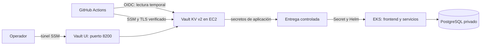

# Boutique Eq4 DevOPS

Extensión del demo **Online Boutique** con panel administrativo persistente y una ruta de despliegue en AWS Academy Learner Lab. El panel cubre ventas, catálogo, inventario y pedidos. La integración actual usa PostgreSQL en local y EKS/Helm en el laboratorio. Pago, envío y correo conservan los simuladores del demo.

**Equipo:** Norberto Suaste y David Gzz.

## Estado y alcance

| Área | Implementación versionada | Evidencia y límite |
| --- | --- | --- |
| Aplicación | Panel con dashboard, catálogo, inventario, pedidos, sesiones y vistas Vault/Ansible | [Integración PostgreSQL](docs/postgres-integration.md), [demo administrativo](docs/demo-management.md) y [operación del panel](docs/admin-operations.md) |
| Seguridad | Vault en EC2 fuera de EKS, Ansible por SSM, TLS, Raft, sello AWS KMS, KV v2, ACL de lectura y OIDC de GitHub | [Guía Vault](docs/vault-lab.md) y [matriz de evidencias](docs/vault-evidence.md). Las pruebas locales no acreditan por sí solas una instalación AWS. |
| Entrega | Merge autorizado de `development` a `main`, pruebas, imágenes ECR con SHA completo y CD a EKS/Helm | [Flujo automático](docs/aws-automatic-deployment.md). La activación exige restauración verificada y comprobaciones KMS/OIDC/TLS. |
| Recuperación | Copia local PostgreSQL restaurada en aislamiento; reconstrucción AWS autorizada usando esa copia | [Informe de recuperación](docs/recovery-2026-10-20.md). Los pedidos anteriores de AWS no aparecieron en las fuentes revisadas. |

El despliegue **ECS/EC2** de [`aws/`](aws/README.md) es una ruta histórica opcional, controlada por `ENABLE_ECS_DEPLOY=true`. Requiere las correcciones de red y roles de la [auditoría de integración](docs/integration-audit-2026-10-13.md). La ruta de la Fase 3 es EKS/Helm.

## Arquitectura y flujo de secretos

Terraform define la infraestructura AWS, incluida la EC2 de Vault separada del clúster, su grupo de seguridad y la clave KMS. Ansible instala y configura Vault de forma repetible sin inicializarlo ni publicar credenciales. La UI nativa se abre por túnel SSM con TLS; el frontend del laboratorio permanece privado y se consulta por `kubectl port-forward`. El rol CI de Vault limita la lectura al material necesario y el token batch dura como máximo 15 minutos. El token raíz y las participaciones de recuperación quedan fuera de Actions.

Las vistas autenticadas `/admin/vault` y `/admin/ansible` muestran salud y ejecuciones. El colector de Vault informa cuando no puede verificar la conexión; la consola Ansible filtra salida y argumentos sensibles. Sin colector conectado, la vista conserva «Sin datos», sin simular una instalación operativa. Ver [operación del panel](docs/admin-operations.md).

## Flujo de actualización y seguridad de producción

```mermaid
flowchart LR
  F[Rama de trabajo] --> PR[PR y revisión en development]
  PR --> M[Merge development a main]
  M --> G[Autorizar SHA y comprobar recuperación]
  G --> T[Pruebas PostgreSQL y Vault]
  T --> B[12 imágenes ECR con SHA]
  B --> D[Ansible, Vault OIDC y Helm en EKS]
  D --> S[Migración, rollout y smoke]
  S --> E[Evidencias y recuperación]
```

1. Los cambios se integran por PR en `development`. El release empieza con un `push` a `main`, pero el gate solo acepta el SHA de un PR fusionado desde `development` en el mismo repositorio. Un push directo, otra rama o un fork no autorizan el despliegue.
2. Antes de construir, el pipeline exige `DATA_RECOVERY_VERIFIED=true`, `VAULT_AUTOMATION_READY=true`, la cuenta AWS esperada, EKS activo y KMS habilitado. Las marcas deben corresponder a verificaciones reales, no a datos demo ni a un backup vacío.
3. Las suites PostgreSQL y Vault se ejecutan sobre el mismo SHA. Después se publican doce imágenes en ECR con la etiqueta del SHA completo; el CD reutilizable recibe ese identificador al terminar todas las publicaciones.
4. El CD serializa despliegues, reanuda recursos conocidos, aplica `ansible/site.yml` a la EC2 exacta por SSM y verifica TLS, Vault y `awskms`. GitHub obtiene acceso temporal de lectura por OIDC. La entrega actualiza el Secret de Kubernetes, ejecuta Helm y la migración, y comprueba login, catálogo y checkout. Ante fallo, conserva la custodia de PostgreSQL y aplica la recuperación prevista para la release.
5. En cada sesión de Learner Lab se renuevan juntos `AWS_ACCESS_KEY_ID`, `AWS_SECRET_ACCESS_KEY` y `AWS_SESSION_TOKEN` como *repository secrets*. Cambiarlos no dispara un workflow. El laboratorio debe estar iniciado; el pipeline no puede reabrir uno cancelado ni recuperar recursos eliminados automáticamente. La [guía de despliegue](docs/aws-automatic-deployment.md) separa preparación inicial, rotación y reintentos.

**Alcance operativo:** Learner Lab y Vault de un solo nodo sirven para demostrar la Fase 3; no son un servicio permanente ni de alta disponibilidad. Un cambio de infraestructura o KMS exige revisar plan, custodia y recuperación antes de aplicar. Nunca versionar `.env`, snapshots, tokens, claves privadas, participaciones ni capturas de valores KV.

## Criterios de evaluación y evidencia

La imagen de la rúbrica anuncia cuatro dimensiones de 25 puntos, pero solo permite leer tres. Se documentan las tres visibles; el cuarto criterio queda **sin especificar** hasta contar con la rúbrica completa. Los puntos expresan el peso de evaluación, no una nota obtenida.

| Criterio visible | Qué demostrar | Dónde revisar |
| --- | --- | --- |
| Seguridad (25 pts) | EC2 de Vault fuera de K8s, TLS y UI, KV v2, ACL de lectura, OIDC/TTL, auditoría y recuperación | [Terraform Vault](terraform/aws/vault/README.md), [Ansible](ansible/README.md), [Vault](docs/vault-lab.md), [evidencias](docs/vault-evidence.md) |
| Accesibilidad y UI (25 pts) | UI de Vault por túnel seguro y panel de operaciones usable en escritorio/móvil; navegación semántica, etiquetas y estados comunicados en las vistas implementadas | [Operación del panel](docs/admin-operations.md) y `src/frontend/templates/admin/`. La revisión local no sustituye una auditoría WCAG formal. |
| Portafolio de evidencias (25 pts) | Topología, diagramas, comandos reproducibles, pruebas, capturas sanitizadas, ejecuciones y límites | [Matriz de Fase 3](docs/vault-evidence.md), [integración](docs/integration-verification-2026-10-13.md), [recuperación](docs/recovery-2026-10-20.md) |

La secuencia de las imágenes adjuntas cubre diseño de infraestructura, aprovisionamiento con Ansible, conexión Vault/CI y pruebas de integración y resiliencia. La [matriz de evidencias](docs/vault-evidence.md) separa resultados locales de capturas y ejecuciones pendientes en Learner Lab.

## Validaciones

| Capa | Comprobación | Estado documentado |
| --- | --- | --- |
| Aplicación local | PostgreSQL, HTTP end to end, persistencia, `go test ./...` y render Helm | [Integración](docs/integration-verification-2026-10-13.md) y [demo](docs/demo-verification-2026-10-14.md) |
| Vault y entrega | Vault temporal TLS/Raft, expiración, revocación, denegación, sellado y recuperación; lint Helm/Ansible/Terraform/Actions | [Evidencias](docs/vault-evidence.md): 29/29 pruebas de la suite Linux reportadas allí |
| UI de operaciones | Navegador de escritorio y móvil, SQL/HTTP, Go, callback/colector y ejecución Ansible local | [Evidencias](docs/vault-evidence.md). No equivale a ejecutar `site.yml` en EC2. |
| AWS real | Infraestructura, SSM/TLS, OIDC, migración, smoke y rollback | Requiere capturas, recaps y enlaces de la nueva instalación. Ver [pendientes](docs/vault-evidence.md). |

Para el entorno local, `./scripts/start-integration.ps1` prepara `.env` si falta, conserva datos existentes, inicia Compose y verifica frontend. `docker compose up -d --build` también carga el override de integración cuando `.env` ya está completo. Ver [arranque y alcance](docs/postgres-integration.md). Las pruebas que crean datos sintéticos son para entornos aislados.

## Guías por componente

| Componente | Guía | Uso |
| --- | --- | --- |
| Ansible | [ansible/README.md](ansible/README.md) | Instalación, TLS y configuración Vault por SSM; idempotencia y migración KMS controlada |
| AWS ECS | [aws/README.md](aws/README.md) | Definiciones de tareas y workflow ECS histórico, opcional |
| Helm | [helm-chart/README.md](helm-chart/README.md) | Chart base; la integración usa `values-postgres.yaml` y `values-vault-lab.yaml` según la guía de despliegue |
| Kustomize | [kustomize/README.md](kustomize/README.md) | Variantes de manifiestos Kubernetes; no sustituye el release EKS/Helm del laboratorio |
| Terraform AWS | [terraform/aws/README.md](terraform/aws/README.md) | Estado y capa de datos; EKS/ECR y Vault viven en subdirectorios propios |

Más detalle: [despliegue automático](docs/aws-automatic-deployment.md), [Vault y custodia](docs/vault-lab.md), [operación de UI](docs/admin-operations.md) y [portafolio](docs/vault-evidence.md).
