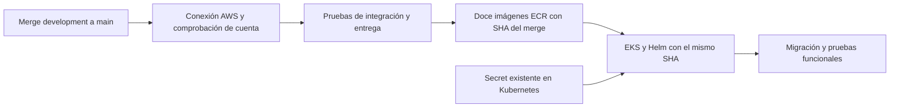

# Despliegue directo a AWS al fusionar development en main

Destino fijo: cuenta **716142453772**, región **us-east-1**, clúster
**boutique-eq4-eks**. El pipeline usa las tres credenciales temporales de la
misma sesión activa del AWS Academy Learner Lab.

## Lo que actualizas en cada sesión

En [Settings → Secrets and variables → Actions](https://github.com/Hacket00GTFO/Boutique-Eq4-DevOPS/settings/secrets/actions),
actualiza estos **Repository secrets** mediante **Update**:

| Nombre exacto | Valor de AWS Details |
| --- | --- |
| `AWS_ACCESS_KEY_ID` | `aws_access_key_id` |
| `AWS_SECRET_ACCESS_KEY` | `aws_secret_access_key` |
| `AWS_SESSION_TOKEN` | `aws_session_token` |

Los tres deben pertenecer a la cuenta **716142453772** y a la misma sesión.
Los workflows los leen con `${{ secrets.NOMBRE }}`; los valores permanecen fuera
del YAML y del repositorio. No se introducen en el chat.

No es necesario cargarlos en WSL para que GitHub despliegue. Tampoco copiarlos al
environment antiguo `vault-lab`: este CD no usa ese environment y lee los secrets
del repositorio. `TF_STATE_BUCKET` se conserva para el workflow separado de datos;
no interviene en esta conexión ECR/EKS.

## Cómo se ejecuta

1. Iniciar **Start Lab** y esperar a que esté activo.
2. Actualizar los tres repository secrets con los valores de **AWS Details**.
3. Abrir un PR desde `development` a `main` en el mismo repositorio y fusionarlo.
4. Seguir **Actions → CI: Docker build & push a ECR**. Al final de esa ejecución
   aparece el job reutilizable **deploy / helm-deploy**.

El pipeline también se activa con merges que solo cambian documentación.
Cerrar un PR sin fusionarlo, fusionar otra rama o un PR de un fork no ejecuta
esta ruta. Se serializan las ejecuciones para conservar el orden de releases.



Los pasos son:

- Fijar el SHA completo del merge y comprobar que pertenece a `main`.
- Autenticar con las tres claves, verificar la cuenta y consultar EKS/ECR. Una
  cuenta distinta falla antes de las construcciones y publicaciones.
- Ejecutar pruebas PostgreSQL, seguridad y entrega; después construir/publicar
  los doce servicios. Ninguna imagen pendiente permite iniciar CD.
- Volver a autenticar CD con las tres claves del repositorio, verificar la cuenta
  y reanudar únicamente las EC2 existentes de los dos node groups conocidos.
- Esperar nodos `Ready`, comprobar imágenes y CSI, leer el Secret de aplicación
  existente y ejecutar Helm, migración y smoke de login, catálogo y checkout.

## Datos y credenciales de aplicación

Se conserva el namespace/release **boutique-vault-lab** para actualizar la
instalación previa y mantener su PVC PostgreSQL. El nombre es histórico; la
conexión del pipeline es directa a AWS.

El Secret **boutique-integration** contiene las nueve claves de aplicación ya
instaladas. CD las lee en memoria y conserva sus valores entre sesiones AWS.
No requiere emitir `VAULT_CI_TOKEN`, configurar OIDC, migrar a KMS, exportar
certificados ni activar variables de Vault. Los procedimientos de Vault y
Ansible siguen disponibles para operación manual y sus pruebas permanecen en CI.

El despliegue mantiene la entrega transaccional existente: si Helm o el smoke
fallan, intenta recuperar la release previa y conserva Secret/PVC. Si falta el
Secret original, se detiene para recuperar la custodia; no inventa contraseñas
nuevas que podrían dejar PostgreSQL inaccesible.

## Requisitos existentes de la cuenta

La cuenta debe conservar EKS, los doce repositorios ECR, sus node groups, el
addon EBS CSI, StorageClass `boutique-ebs-gp3`, namespace y Secret de aplicación.
El workflow actualiza esa instalación; la creación o recuperación de recursos
eliminados corresponde a Terraform y al procedimiento de custodia.

El Learner Lab debe estar activo y tener presupuesto y permisos de servicio.
GitHub no inicia la sesión de AWS Academy ni prolonga su temporizador. Si caduca
durante una ejecución, actualizar los tres secrets y repetir.

## Reintentar sin otro merge

Actualizar un secret no dispara un workflow. Desde **Actions**, ejecutar:

- **CI: Docker build & push a ECR → Run workflow → main** para probar, construir
  y desplegar el SHA actual de `main`.
- **CD: Helm deploy a EKS → Run workflow → main** para usar un SHA completo que
  ya tenga todas sus imágenes publicadas.

Para comprobar la conexión antes del merge, ejecutar **CI: Docker build & push
a ECR → Run workflow → development**. En esa rama solo se ejecuta `connection`:
consulta cuenta, EKS y ECR. La construcción y el deploy están limitados a `main`.

## Abrir la aplicación

Para acceder desde Ubuntu, esa terminal sí necesita las tres claves AWS de la
misma sesión. Después:

```bash
aws eks update-kubeconfig --name boutique-eq4-eks --region us-east-1 &&
kubectl -n boutique-vault-lab get pods,pvc &&
kubectl -n boutique-vault-lab port-forward service/frontend 8080:80
```

Abrir `http://localhost:8080`. La terminal mantiene el túnel hasta Ctrl+C.
El frontend sigue privado. Un error `voc-cancel-cred` exige reactivar el Lab y
renovar sus tres claves; `ResourceNotFoundException` exige verificar primero la
cuenta **716142453772**, la región y la infraestructura existente.
