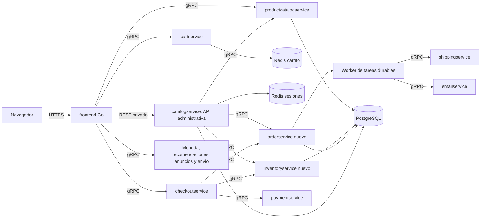

# Auditoría y plan de integración: frontend, contenedores y PostgreSQL

Fecha: 13 de octubre de 2026, America/Mexico_City. Commit analizado: `45ce2808`.

Este documento conserva el diagnóstico inicial. La integración desarrollada
posteriormente y su alcance están en [postgres-integration.md](postgres-integration.md).

## Resultado de la revisión

**La tienda se comunica correctamente con el backend del demo en Docker local. El panel administrativo todavía no tiene integración funcional con un backend real y PostgreSQL no está integrado.** Se ejecutaron 31 comprobaciones con resultado satisfactorio. El alcance fue el entorno local existente; no se verificó una cuenta AWS, un clúster remoto ni una base PostgreSQL externa.

El frontend es un servidor Go que renderiza HTML y actúa como capa de entrada al backend. El navegador envía HTTP al frontend; este usa gRPC para hablar con los servicios de la tienda. No hace falta agregar CORS para estas llamadas internas. El panel también se renderiza en Go, pero lee `mockAdminData` en lugar de servicios reales.

Se entregan un diagnóstico, una propuesta técnica y una secuencia ejecutable de trabajo. **La integración descrita a partir de la arquitectura objetivo es propuesta, todavía no implementada.** Se añadió únicamente documentación y un script reproducible de auditoría local.

## Evidencia y limitaciones

- `docker compose config --quiet`: configuración válida.
- 11 contenedores existentes en ejecución sobre `boutique-eq4-devops_default`; 6 con healthcheck de Docker y 5 sin él.
- Los 9 servicios gRPC respondieron `SERVING` y resolvieron su nombre dentro de la red.
- Catálogo: 9 productos; recomendaciones, anuncios, conversión USD/EUR y cotización de envío respondieron correctamente.
- Navegación HTTP, cambio de moneda, alta en carrito y lectura de ese mismo carrito mediante gRPC: correctos.
- Compra simulada: respuesta HTTP 200 con identificador de pedido; el carrito de la sesión de prueba quedó vacío.
- Acceso administrativo sin sesión redirigió al login; login de demo y las cuatro vistas administrativas respondieron correctamente. Esto acredita navegación y autenticación de demo, no persistencia ni funcionalidades del back-office.
- No se ejecutaron pagos reales ni se enviaron correos: `paymentservice` simula el cobro y `emailservice` usa `DummyEmailService`. El envío también es simulado.
- No se reconstruyeron imágenes. Las pruebas describen los contenedores actuales; el análisis estático describe el checkout del repositorio. No se acreditó que todas las imágenes correspondan exactamente al commit analizado.
- No se hicieron pruebas de carga, interrupciones ni restauraciones de datos. Los tiempos de dos ejecuciones variaron; no permiten afirmar un SLA.

Evidencia resumida: [integration-audit-2026-10-13.md](integration-audit-2026-10-13.md).

## Hallazgos priorizados

P0 bloquea una integración real o el despliegue elegido; P1 debe resolverse antes de una entrega confiable; P2 mejora mantenimiento y rendimiento.

| ID | Prioridad | Evidencia en el repositorio | Efecto y solución |
| --- | --- | --- | --- |
| H01 | P0 | `src/frontend/admin_handlers.go:35` inicializa `mockAdminData`; `admin_data.go:108` define una interfaz sin contexto ni errores. | Dashboard, catálogo, inventario y pedidos muestran datos simulados. Sustituir el proveedor por clientes reales y cambiar la interfaz para recibir contexto y devolver errores. |
| H02 | P0 | `src/catalogservice/main.py:15` solo ofrece GET `/catalogo`, con `DynamoDB.scan(Select="COUNT")`; Compose no incluye ese servicio. | No hay listado de productos, CRUD, inventario, pedidos ni PostgreSQL. El conteo tampoco pagina un scan completo. Transformar el servicio en API administrativa con contratos versionados. |
| H03 | P0 | `docker-compose.yml` no define PostgreSQL; `terraform/aws/catalogo.tf:5` crea DynamoDB; Helm inyecta `TABLE_NAME`. | La infraestructura actual no satisface la base solicitada. Incorporar PostgreSQL, migraciones y roles; realizar una transición controlada de DynamoDB. |
| H04 | P0 | `productcatalogservice/catalog_loader.go:37` usa AlloyDB si existe `ALLOYDB_CLUSTER_NAME`; de otro modo lee `products.json`. | El catálogo del storefront es distinto del catálogo administrativo. El soporte AlloyDB depende de GCP y no equivale a una conexión genérica a PostgreSQL. Crear un repositorio PostgreSQL compartido por las operaciones del servicio de productos, conservando IDs y RPC existentes. |
| H05 | P0 | `checkoutservice/main.go:230` cobra, solicita envío, vacía carrito y devuelve una orden; no persiste la orden. | El panel no puede consultar compras reales. Crear almacenamiento de pedidos, ítems y estados; integrar checkout con reservas e idempotencia. |
| H06 | P0, si se usa EKS | `ci-docker-ecr.yaml` y `cd-helm-eks.yaml` reaccionan por separado a `push`; CD no espera CI y usa `github.sha`. | Puede desplegar imágenes todavía inexistentes. Un cambio solo en Helm tampoco construye imágenes para su nuevo SHA. Encadenar build y deploy, usando un manifiesto de imágenes ya publicadas. |
| H07 | P0, si se usa ECS | Task definitions usan `bridge`, nombres cortos y puertos de host fijos. `aws/README.md` propone registros A de Cloud Map. | La configuración documentada no completa el descubrimiento compatible con `bridge`; además 8080 y 50051 se repiten, lo que impide colocar ciertas tareas juntas en una instancia. Elegir EKS o rediseñar ECS con Service Connect o `awsvpc` y resolución explícita. |
| H08 | P0, si se usa ECS | `deploy-aws-prod.yaml:178` y otros pasos pasan `containers:` al render action v1; persisten placeholders `AWS_ACCOUNT_ID` en roles. | El action requiere `container-name` e `image`; el workflow no sustituye el ARN de ejecución. Corregir inputs y roles antes de intentar ese despliegue. |
| H09 | P1 | `frontend/main.go:239` y `checkoutservice/main.go:212` crean un contexto de 3 segundos y lo descartan; `grpc.NewClient` no prueba disponibilidad. `checkoutservice/main.go:360` usa `context.TODO()`. | No hay un límite efectivo para esas operaciones y la cancelación se pierde en conversión de moneda. Aplicar deadlines en cada RPC y propagar el contexto del request. |
| H10 | P1 | Go/chiseled sin probes en Compose; los otros probes son TCP. `/_healthz` y `/healthz` responden sin verificar dependencias. | Un proceso iniciado o un puerto abierto no acredita readiness. Agregar probes gRPC/HTTP y readiness que compruebe dependencias imprescindibles. Un binario de probe puede ejecutarse con `CMD` sin shell. |
| H11 | P1 | `frontend/admin_auth.go:42,44,106`: contraseña predeterminada, sesiones en memoria, cookie sin `Secure`. | Login de demo funciona, pero reinicios o réplicas pierden/fragmentan sesiones y falta autorización de backend. Usuarios con hash, roles, sesiones compartidas y protección de mutaciones. |
| H12 | P1 | Redis no monta volumen en Compose. Consulta local: AOF desactivado, snapshots configurados. | Una recreación puede perder carritos. Definir política de durabilidad, volumen y AOF si se requiere, TTL y recuperación; pedidos y stock deben persistir en PostgreSQL. |
| H13 | P1 | `frontend/handlers.go:472` usa `http.DefaultClient`, request sin contexto, sin cierre del body ni comprobación del status. | El asistente puede bloquear requests y consumir recursos. Cliente con timeout, contexto, cierre del body, límite de respuesta y traducción de errores. Mantenerlo opcional y devolver 503 si está deshabilitado. |
| H14 | P1 | `docs/admin-panel.md` y templates enumeran acciones visuales sin endpoints; paginación mock ignora página real. | Alta, edición, baja, ajuste de stock, detalles y exportación no están conectados. Implementar formularios, handlers, validaciones y estados de error por módulo. |
| H15 | P2 | Frontend convierte precios y recupera productos recomendados secuencialmente; recomendaciones Python llama al catálogo sin timeout. Task definitions ECS no tienen logs ni healthchecks. | Aumenta la latencia por salto y limita el diagnóstico. Reutilizar conexiones, concurrencia acotada, deadlines Python y trazas/métricas por operación. |

Las observaciones AWS son hallazgos de configuración, no fallos reproducidos en una cuenta remota. El pipeline del repositorio que crea comentarios no se ejecutó como parte de esta auditoría.

La documentación oficial confirma las condiciones `service_healthy` de [Docker Compose](https://docs.docker.com/compose/how-tos/startup-order/), los requisitos de red de [ECS Service Discovery](https://docs.aws.amazon.com/AmazonECS/latest/developerguide/service-discovery.html), los inputs de [amazon-ecs-render-task-definition v1](https://github.com/aws-actions/amazon-ecs-render-task-definition/blob/v1/action.yml) y la aplicación de [deadlines gRPC](https://grpc.io/docs/guides/deadlines/).

## Arquitectura objetivo recomendada

Mantener el frontend Go como puerta HTTP y capa de presentación. Para este proyecto, tomar **Docker Compose como entorno local y EKS/Helm como destino AWS propuesto**, porque ya existe Terraform EKS y el servicio administrativo ya tiene Helm. ECS queda como alternativa que necesita correcciones propias. La elección definitiva debe contrastarse con el presupuesto y permisos del Learner Lab antes de aprovisionar; la propuesta no implica desplegar nuevos recursos.

Implementar la extensión como un override de Compose y valores Helm opt-in, en línea con `docs/product-requirements.md`. En el despliegue del equipo, activar explícitamente la extensión. El modo demo debe seguir disponible para los ejemplos base; el modo real debe fallar si faltan sus dependencias y nunca mostrar mocks como si fueran datos de producción.



Se conserva temporalmente el nombre `catalogservice` para reducir cambios de despliegue; su responsabilidad objetivo será el acceso administrativo, autenticación, composición de respuestas y reportes. Los dominios de productos, inventario y pedidos tienen un único propietario cada uno. Cada servicio solo escribe su esquema PostgreSQL. No conectar el navegador a PostgreSQL ni distribuir acceso SQL entre todos los contenedores.

Los dos servicios nuevos separan la concurrencia de stock y la durabilidad de pedidos. Si el equipo necesita reducir contenedores para el laboratorio, esos dominios pueden empezar como módulos del backend administrativo, con la misma separación de contratos y ownership; esa simplificación debe decidirse en la fase 0 antes de escribir migraciones.

## Matriz de comunicación por contenedor

Los puertos nuevos son propuestos; las llamadas existentes conservan su contrato gRPC. El puerto indicado es interno al contenedor, salvo la entrada del frontend.

| Servicio | Entrada | Dependencias salientes objetivo | Persistencia y criterio de salud |
| --- | --- | --- | --- |
| frontend | HTTP 8080; HTTPS en ingress/ALB | Catálogo 3550, carrito 7070, checkout 5050, moneda 7000, recomendaciones 8080, envío 50051, anuncios 9555; API administrativa HTTP | Sin SQL. Liveness local; readiness de rutas tienda/admin con estado separado. |
| catalogservice | REST 8080; Kubernetes Service 80 | Catálogo gRPC, inventario 50052, pedidos 50053, Redis sesiones 6379 | PostgreSQL `identity` y proyección `reporting`; readiness de DB y contratos críticos. |
| productcatalogservice | gRPC 3550 | PostgreSQL 5432 | Propietario `catalog`; lecturas/escrituras coherentes y probe DB. |
| cartservice | gRPC 7070, HTTP/2 | redis-cart 6379 | Redis; probe existente que verifica el store. Añadir variante al contrato. |
| redis-cart | Redis 6379 | Ninguna | Volumen local y política AOF/TTL definida; no acceso público. |
| redis-sessions, nuevo | Redis 6379 | Ninguna | Sesiones compartidas con TTL; expulsión/reinicio invalida login, no altera pedidos. Puede consolidarse en laboratorio con prefijos y política explícita. |
| checkoutservice | gRPC 5050 | Carrito, catálogo, moneda, pago; inventario y pedidos nuevos | Orquestación, sin SQL propio. Correo/envío pasan a tareas durables después de confirmar pago. |
| inventoryservice, nuevo | gRPC 50052 | PostgreSQL 5432 | Propietario `inventory`; reservas atómicas, expiración y movimientos auditados. |
| orderservice, nuevo | gRPC 50053 | PostgreSQL 5432; llamadas de recuperación a inventario/pago | Propietario `orders`; máquina de estados, idempotencia, outbox y conciliación. |
| orderworker, nuevo proceso/contenedor | Sin entrada pública | API de pedidos para reclamar/completar tareas; envío 50051 y correo 8080 | Tareas durables del dominio orders; credencial interna; reintentos controlados. |
| currencyservice | gRPC 7000 | Ninguna actualmente | Datos locales del demo; refresh/cache si luego se usan cotizaciones externas. |
| recommendationservice | gRPC 8080 | Catálogo 3550 | Sin DB propia; timeout y degradación si no hay recomendaciones. |
| paymentservice | gRPC 50051 | Proveedor de pago cuando se habilite | Hoy simulador. Antes de cobros reales, tokenización, idempotencia de proveedor, consulta de estado y compensación. |
| shippingservice | gRPC 50051 | Proveedor logístico cuando se habilite | Hoy simulador. Almacenar tracking en pedidos; operaciones repetidas deben conservar el resultado. |
| emailservice | gRPC 8080 | Proveedor de correo cuando se habilite | Hoy dummy. Deduplicación por pedido/tipo; envío no bloquea respuesta al comprador. |
| adservice | gRPC 9555 | Ninguna actualmente | Opcional para compra; degradación sin anuncios. |
| loadgenerator | Sin entrada pública | frontend 8080 | Perfil de pruebas; datos sintéticos; nunca activarlo como requisito de disponibilidad. |
| shoppingassistantservice | HTTP 8080; Service Kubernetes 80 | GCP/Vertex/AlloyDB según configuración actual | Perfil opcional, no dependencia de compra ni readiness global. No es necesario migrarlo para integrar PostgreSQL transaccional. |
| postgres, nuevo local | PostgreSQL 5432 | Ninguna | Volumen, `pg_isready`, migraciones y backup/restore. AWS: RDS PostgreSQL privado si los permisos lo permiten. |
| migrate, nuevo job | Sin entrada pública | PostgreSQL 5432 | Ejecución única por release, con rol DDL independiente; aplicación espera migración satisfactoria. |
| otel-collector, opcional | OTLP 4317 | Almacenamiento de trazas/métricas | Recibe telemetría existente; ausencia no debe impedir una compra. |

En Compose: usar nombres de servicio y puerto interno, por ejemplo `postgres:5432`. En Kubernetes: `catalogservice:80` para la API administrativa y `productcatalogservice:3550` para gRPC; los Service `port` pueden diferir del `containerPort`. Entre namespaces usar FQDN. Publicar únicamente frontend/ingress; DB, Redis y APIs internas permanecen privados.

## PostgreSQL: modelo y conexión

Una instancia inicial con base `boutique` y esquemas separados es suficiente para el proyecto. Usar una versión mayor soportada, fijar versión/digest y comprobar compatibilidad de drivers en fase 1. En AWS proponer RDS privado, cifrado, backups y conexiones TLS verificadas; en laboratorio, revisar disponibilidad y costo antes de crear recursos.

| Esquema / dueño | Entidades mínimas | Restricciones y consultas |
| --- | --- | --- |
| catalog / productcatalogservice | products, categories, product_categories, variants | ID de producto estable, SKU único, moneda explícita, precio exacto, status, timestamps y versión optimista. |
| inventory / inventoryservice | warehouses, stock, reservations, reservation_items, stock_movements | Unique(variant_id, warehouse_id), on_hand >= 0, reserved >= 0, reserved <= on_hand; expiración y llave de operación única. |
| orders / orderservice | orders, order_items, payments, status_history, idempotency_keys, outbox | Snapshot de nombre/SKU/precio/moneda al comprar, llave idempotente única por ámbito, transacción de estado+outbox. |
| identity / catalogservice | admin_users, roles, user_roles, audit_log | Email normalizado único, password_hash, cuenta activa; actor, entidad, cambio y request_id. Sesiones opacas en Redis. |
| reporting / catalogservice | proyecciones de órdenes, ventas, clientes y descuentos | Fuente de eventos persistidos; deduplicación por event_id y punto de avance. Definir frescura y reconciliación. |

Claves foráneas dentro de cada dominio; referencias entre dominios se validan por contrato y conservan IDs. Evitar joins de escritura entre esquemas o que el frontend consulte tablas. No guardar PAN/CVV en pedidos o logs; el método de pago muestra token/referencia y últimos dígitos permitidos.

Persistir importes con precisión exacta y mapearlos al proto `Money.units/nanos` sin `float`. Guardar `timestamptz` en UTC y presentar fechas con la zona del negocio. Indexar por búsquedas reales: productos(status, categoría), pedidos(created_at, id), pedidos(status, created_at), reservas(expires_at, status) y stock(variant_id, warehouse_id). Determinar índices adicionales con `EXPLAIN ANALYZE`, después de disponer de datos representativos.

Usar un pool por proceso, creado al arrancar y cerrado durante shutdown. Configurar timeout de conexión, espera del pool, `statement_timeout` y `lock_timeout`. Presupuesto de conexiones: suma de réplicas × workers por réplica × pool máximo, más migración/reportes y margen, siempre menor que `max_connections`. PgBouncer queda condicionado a mediciones; no añadirlo sin necesidad.

Variables de configuración propuestas:

```text
ADMIN_DATA_MODE=backend
ADMIN_API_BASE_URL=http://catalogservice:8080       # Compose
ADMIN_API_BASE_URL=http://catalogservice:80         # Kubernetes
INVENTORY_SERVICE_ADDR=inventoryservice:50052
ORDER_SERVICE_ADDR=orderservice:50053
DATABASE_URL=<secreto distinto para cada propietario de esquema>
SESSION_REDIS_ADDR=redis-sessions:6379
RPC_READ_TIMEOUT_MS=1500
CHECKOUT_TIMEOUT_MS=8000
HTTP_UPSTREAM_TIMEOUT_MS=3000
DB_POOL_MAX=<calculado según workers y réplicas>
SHOPPING_ASSISTANT_ENABLED=false
```

Estos valores de timeout son hipótesis iniciales que deben ajustarse con carga y proveedores reales. No introducir contraseñas en manifests, logs o URLs públicas. En local usar secretos/archivo excluido de Git; en AWS el mecanismo permitido por el Lab y Kubernetes Secret/Secrets Manager según permisos. Los roles de aplicación no deben ser superusuarios ni propietarios de toda la instancia.

Migraciones versionadas por dominio, ejecutadas antes del rollout, con patrón expandir → desplegar compatible → retirar columnas en otra entrega. Seeds únicamente en demo/test. No eliminar DynamoDB hasta inventariar/exportar datos, validar conteos e importes y probar rollback; el repo no acredita si la tabla remota contiene información útil.

## Contratos del panel administrativo

El navegador conserva las páginas actuales. Sus formularios y acciones hablan con handlers del frontend, que llaman a `/api/v1` en `catalogservice`. Autenticación y permisos también se validan en el backend: esconder un botón no autoriza una operación.

| Módulo | Endpoints internos propuestos | Integración en frontend |
| --- | --- | --- |
| Autenticación | POST `/api/v1/auth/login`, POST `/auth/logout`, GET `/auth/me` | Reemplazar comparación de credenciales y mapa local; sesión compartida, roles y cookie Secure en HTTPS. |
| Dashboard | GET `/api/v1/dashboard?from=&to=&timezone=` | KPIs, series, ranking y actividad con datos persistidos; incluir as_of y frescura. |
| Catálogo | GET/POST `/api/v1/products`, GET/PATCH/DELETE `/products/{id}` | Buscar, filtrar, paginar, crear, editar y archivar; las escrituras pasan al dueño gRPC del catálogo. |
| Variantes | GET/POST `/api/v1/products/{id}/variants`, PATCH `/variants/{id}` | SKU, talla/color y selección de variante también en storefront/carrito. |
| Inventario | GET `/api/v1/inventory?warehouse_id=&stock=&page=`, POST `/inventory/adjustments` | Ajuste con motivo y actor; bloquear cambios que violen reservas; historial auditable. |
| Pedidos | GET `/api/v1/orders?from=&to=&status=&page=`, GET `/orders/{id}`, PATCH `/orders/{id}/status` | Detalle y transiciones válidas; cancelación con compensación, no borrado de histórico. |
| Exportación | GET `/api/v1/exports/{resource}?from=&to=` | CSV con filtros y permisos; neutralizar fórmulas; exportaciones grandes mediante job y descarga autenticada. |
| Descuentos/clientes | Endpoints o proyecciones definidos en fase 2 | El demo carece de cuentas de comprador y campañas. Definir cliente identificado por compra/email o crear dominio de cliente; no inventar KPI. |

Las rutas abreviadas en una fila también quedan bajo `/api/v1`. GET lista: `items`, `page`, `page_size`, `total`; límite de tamaño y orden estable. Respuesta de error: `code`, `message`, `request_id`, `field_errors`. Estados HTTP: 400/422 validación, 401 autenticación, 403 permisos, 404 inexistente, 409 conflicto/stock/version, 503 dependencia no disponible y 504 timeout. Mapear errores gRPC de forma coherente y sin exponer detalles internos.

Cambiar `AdminDataProvider` hacia métodos equivalentes a `Products(context.Context, ProductsQuery) (AdminCatalogPage, error)` y similares. Tipos internos con IDs, fechas e importes, y formato de moneda en la presentación. Los handlers deben representar carga/error/vacío y preservar filtros al paginar. Agregar handlers POST para formularios con CSRF y traducción de errores; validación autoritativa también en cada servicio.

Definir OpenAPI y el proto canónico en `protos/`; regenerar todas las copias con tooling fijado. Agregar RPC de mutación al catálogo y contratos de pedidos/inventario. Agregar campos compatibles para variantes y llave idempotente sin reutilizar números proto. No basta con añadir CRUD administrativo: el storefront debe comprar el mismo producto/variante que se administra.

## Checkout, consistencia y recuperación

No mantener una transacción SQL abierta durante llamadas a pago o envío. No existe una transacción ACID que cubra PostgreSQL, Redis y todos los RPC; usar una saga con estados persistidos y operaciones idempotentes.

1. El frontend genera y conserva una llave de compra para un intento; checkout valida carrito, variante, cantidades y precios del catálogo. Repetir la misma llave devuelve el mismo resultado.
2. `orderservice` crea un pedido pendiente y conserva snapshots y progreso. `inventoryservice` reserva stock por `order_id`; controla concurrencia con actualización condicional o locks por fila, orden de locks estable y una reserva única.
3. `paymentservice` recibe llave idempotente y responde con referencia. Ante timeout ambiguo se consulta estado; no se vuelve a cobrar a ciegas. El simulador actual necesita ese contrato antes de conectar un proveedor real.
4. Pago rechazado: persistir fallo y liberar reserva de forma idempotente. Pago confirmado: marcar el estado durable y consumir la reserva. Si una RPC falla, conservar estado pendiente y reconciliar mediante worker; expiración de reservas debe coordinarse con pagos en curso.
5. Estado confirmado y eventos de outbox se escriben en una transacción del dominio de pedidos. El carrito se limpia después; si falla, registrar/reintentar sin convertir una compra ya pagada en un error que provoque otro cobro.
6. Worker reclama tareas con lease y reintenta con backoff. Entrega al menos una vez: envío, correo y proyecciones requieren deduplicación. Agotar reintentos produce estado visible y tarea de conciliación.
7. Envío fallido después de pago deja pedido pagado pendiente de envío; aplicar la política de cancelación/reembolso acordada. No borrar el pedido ni reportar falsamente que no se cobró. Las compensaciones de pago real requieren capacidades del proveedor aún inexistentes.

Para evitar sobreventa, las reservas deben ser atómicas y probadas con concurrencia; PostgreSQL documenta el comportamiento de [bloqueos por fila](https://www.postgresql.org/docs/current/explicit-locking.html). Definir una máquina de estados separada para pago y logística, sin mezclar `Active` de producto con `ENTREGADO` de pedido. Los estados deben mapearse al vocabulario de las pantallas.

## Comunicación, disponibilidad y rendimiento

- Propagar `context` y deadline en frontend → servicio → dependencia; eliminar `context.TODO()` en operaciones de un request. Python debe pasar timeout calculado con el tiempo restante.
- Reusar clientes gRPC y pools HTTP/SQL. Hacer lecturas independientes en paralelo con límite de concurrencia. Cache corta para moneda/catálogo con invalidación al editar; checkout siempre valida precio/stock vigentes.
- Reintentar solo lecturas seguras o escrituras con idempotencia probada. No reintentar indiscriminadamente Charge, PlaceOrder o ShipOrder. Backoff, jitter, límite de intentos y presupuesto total.
- Distinguir liveness de readiness. En Compose, añadir binarios de probe para Go/chiseled y `depends_on: service_healthy`; migración con `service_completed_successfully`. Reiniciar por salida del proceso no es un mecanismo de recuperación ante un RPC fallido.
- En EKS, startup/readiness/liveness, límites de recursos, shutdown ordenado y despliegue con disponibilidad. Prever un volumen temporal para Gunicorn si se conserva filesystem de solo lectura; verificar permisos y arranque con esa política.
- Recomendaciones, anuncios y asistente se degradan sin bloquear compra. Catálogo, carrito, inventario, pago y pedidos sí tienen errores explícitos. Health no debe reiniciar en cascada todo el sistema ante una dependencia opcional.
- Request ID y trace context entre HTTP/gRPC; métricas de latencia por RPC, errores, espera de pool, reservas, tareas atrasadas y pagos pendientes. Health no sustituye pruebas funcionales.
- NetworkPolicy/SG limitan los flujos de la matriz. Autenticar llamadas privilegiadas entre servicios con identidad interna; TLS/mTLS según plataforma. HTTPS de entrada, RBAC, CSRF, rate limiting de login y logs sin secretos.

No todos los contenedores necesitan PostgreSQL. Moneda, anuncios, recomendaciones, correo y envío pueden seguir detrás de sus contratos, mientras pedidos/catálogo/inventario preservan el estado transaccional.

## Secuencia de ejecución

Estimación orientativa: **18–27 días-persona** para un equipo familiarizado con el repo, sin proveedores reales de pago/correo/envío. No es un compromiso de calendario; depende de alcance, permisos de AWS y datos que deban migrarse.

| Fase | Prioridad / esfuerzo | Trabajo concreto y archivos principales | Criterio de salida |
| --- | --- | --- | --- |
| 0. Decisiones y baseline | P0 / 1–2 días | ADR de EKS/ECS, dominios separados o módulos, modo demo/real, definición de KPIs y variantes. Revisar README, `aws/`, `terraform/aws/k8s/`, workflows. | Arquitectura única para el equipo, contratos preliminares y reproducción del smoke actual. |
| 1. Datos y despliegue local | P0 / 2–3 días | Override `docker-compose.admin.yml`, PostgreSQL, sesiones Redis, migrator, secretos de ejemplo, readiness; Terraform/Helm de datos según destino. | Arranque desde cero y volumen conservan datos; migración falla sin lanzar aplicación incompatible; backup restaurable en entorno de prueba. |
| 2. Contratos y autenticación | P0–P1 / 2–3 días | OpenAPI, `protos/`, `src/catalogservice/`, `frontend/admin_auth.go`, proveedor con contexto/errores. | Sesión funciona con dos réplicas; operaciones sin permisos son rechazadas por backend; modo real sin DB no muestra mocks. |
| 3. Catálogo integrado | P0 / 3–4 días | PostgreSQL en `productcatalogservice`, nuevos RPC CRUD, REST administrativo, formularios y handlers Go. Importación `products.json` y datos remotos si existen. | Producto creado/editado en admin aparece actualizado en tienda y checkout; filtros, paginación y archivado coherentes. |
| 4. Inventario real | P0 / 3–4 días | `inventoryservice` o módulo equivalente, migraciones, variantes en proto/carrito/frontend, reservas y ajustes. | Dos compras compiten por la última unidad y solo una reserva; sin stock negativo; historial y permisos. |
| 5. Pedidos durables | P0 / 3–5 días | `orderservice`, checkout, worker/outbox, idempotencia en pago/envío, listado/detalle/transiciones. | Compra persiste tras reinicios; mismo intento no duplica pedido/cobro; fallo parcial tiene estado recuperable. |
| 6. Dashboard y acciones restantes | P1 / 2–3 días | Proyecciones reporting, métricas definidas, filtros/búsqueda, exportaciones y UI vacía/error. | Totales concilian con pedidos y moneda; inventario/pedidos/admin coinciden con datos persistidos; exportación aplica filtros. |
| 7. CI/CD y validación completa | P1–P2 / 2–3 días | Build→migrate→deploy→smoke, tag/digest por servicio, Helm/network policies, telemetría y pruebas de carga/fallos. | Release desde imágenes existentes, smoke obligatorio, rollback probado y umbrales documentados. |

Cada fase debe incluir su verificación; no postergar contratos, seguridad y pruebas hasta el final. Entregar PRs pequeños por fase sin desplegar automáticamente una migración irreversible.

Si se mantiene ECS, cerrar H07/H08 primero: inputs oficiales del action, ARN real, logs/probes, nombres resolubles, puertos y capacidad. El despliegue de `shoppingassistantservice` debe ser opt-in y no fallar el release principal por falta de GCP.

Para EKS, un mismo workflow con dependencias `needs` simplifica la cadena. Si se usa `workflow_run`, desplegar el `head_sha` del build exitoso y verificar origen; no el SHA del workflow de CD. Para cambios solo en Helm, reutilizar manifiesto de digests de la última release validada o ejecutar build explícitamente. Sustituir el registro AWS hardcodeado en values por configuración del entorno.

## Pruebas de aceptación de la integración

| Prueba | Evidencia requerida |
| --- | --- |
| Arranque limpio | Red creada, DB lista, migración única y todos los servicios críticos ready; sin dependencia de credenciales GCP para tienda/admin. |
| CRUD de producto | Crear/editar/archivar desde UI modifica PostgreSQL y se refleja en storefront; errores de validación/conflicto visibles. |
| Compra persistente | Pedido/ítems/pago/stock consistentes en DB y panel; reiniciar contenedores conserva histórico. |
| Concurrencia de stock | Compra paralela de última unidad y ajuste simultáneo; una sola reserva, sin cantidades negativas ni reservas huérfanas. |
| Idempotencia | Dos submits con misma llave y timeout ambiguo producen un solo pedido y un solo cobro; envío deduplicado. |
| Recuperación | Pago rechazado, caída de inventario/pedidos, correo/envío fallido y DB temporalmente no disponible; compensación o estado pendiente comprobable. |
| Sesiones/roles | Dos réplicas sin afinidad mantienen login; lector no muta catálogo; CSRF/expiración/logout correctos. |
| Queries y reportes | Páginas sin duplicados, filtros combinados correctos, snapshots históricos sin alterarse al editar precios, ventas por moneda y fechas conciliadas. |
| Despliegue | Ninguna referencia a imagen inexistente/placeholders; migración compatible; smoke de tienda/admin; rollback de aplicación conserva datos. |
| Carga | Inicialmente proponer 10 usuarios, 10 min; p95 de lectura < 1 s y compra simulada < 3 s, errores < 1%; ajustar objetivo con entorno y proveedores. No afirmar estos valores con la auditoría actual. |
| Backup/restore | Restauración en base aislada con conteos/importes/stock validados y tiempo de recuperación registrado. |

La integración se considera completa cuando catálogo, inventario, pedidos, dashboard y todas las acciones comprometidas usan datos persistidos coherentes; las pruebas anteriores pasan en local y en el destino elegido. La navegación exitosa del panel actual no cumple ese criterio.

## Reproducir la auditoría actual

Con los contenedores del demo ya en ejecución, desde PowerShell en la raíz del repo:

```powershell
docker compose config --quiet
docker compose ps
Get-Content scripts/audit-local-integration.py -Raw | docker compose exec -T recommendationservice python -
```

El script usa el Python, gRPC y stubs del contenedor existente; no instala dependencias. Crea una sesión aislada, realiza una compra simulada, limpia su carrito y cierra la sesión administrativa. Su JSON registra resultados y tiempos; código de salida 1 si falla alguna comprobación. Está limitado al demo local; no ejecutarlo contra un proveedor real o producción.
