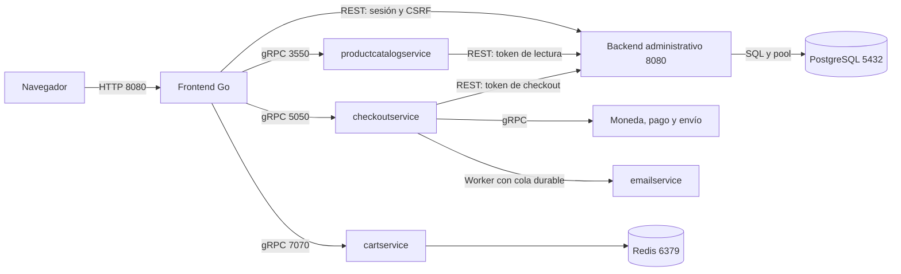

# Integración implementada con PostgreSQL

La extensión conecta el panel administrativo, el catálogo gRPC y checkout a un
backend modular en `src/catalogservice`. PostgreSQL es la fuente única de
productos, stock, pedidos, usuarios y sesiones. El frontend Go conserva la
presentación y los microservicios del demo mantienen sus contratos gRPC.

## Arranque local

Desde la raíz del repo, en PowerShell:

```powershell
./scripts/start-integration.ps1
```

El script genera `.env` si falta, valida Compose, construye e inicia ambos
archivos y comprueba las dependencias del frontend en `/_readyz`. Funciona en
Windows PowerShell 5.1 y PowerShell 7. Para iniciar usando imágenes ya
construidas, agregar `-SkipBuild`. También se puede ejecutar manualmente:

```powershell
./scripts/setup-integration.ps1
docker compose -f docker-compose.yml -f docker-compose.admin.yml up -d --build --wait
```

Tienda: `http://localhost:8080`. Administración:
`http://localhost:8080/admin/login`. Las credenciales `ADMIN_EMAIL` y
`ADMIN_PASSWORD` están en `.env`, que el script genera con secretos aleatorios
independientes y que Git excluye. No hay contraseña predeterminada en modo
backend. El script no sobrescribe un `.env` existente; completar las claves
faltantes según `.env.example`. Usar contraseñas URL-safe en las URLs locales.

Este arranque ejecuta las migraciones antes del backend. El seed de desarrollo
importa los nueve productos existentes con 100 unidades de stock de demo cada
uno; no sobrescribe productos modificados en reinicios. Los nuevos productos
empiezan con stock cero: agregar existencias desde Inventario.

`docker-compose.yml` por sí solo conserva el modo demo original. Para trabajar
con la integración, usar siempre ambos archivos; levantar solo el archivo base
desactiva las conexiones nuevas.

Si se ejecutó `docker compose up` con el archivo base, la advertencia de
contenedores huérfanos puede mencionar `postgres`, `catalogservice` y `migrate`.
Esos contenedores pertenecen a la integración: ejecutar `start-integration.ps1`
para recuperar las conexiones. No usar `--remove-orphans` para corregir esta
advertencia, ya que eliminaría servicios necesarios.

Para detener sin borrar datos:

```powershell
docker compose -f docker-compose.yml -f docker-compose.admin.yml stop
```

Los volúmenes `boutique-postgres` y `boutique-redis` conservan datos al recrear
contenedores. `down -v` borra esos datos y no debe usarse para un reinicio normal.
PostgreSQL y el backend administrativo no publican puertos al host.

## Responsabilidades y comunicación



Se eligió la alternativa modular del plan: no se añadieron contenedores
separados para pedidos e inventario. Los módulos `catalog.py`, `orders.py`,
`auth.py` y `reports.py` comparten una transacción local cuando necesitan
actualizar pedido y stock, con PostgreSQL bajo un único propietario de datos.
Así no se distribuyen escrituras SQL entre frontend y microservicios.

El catálogo de la tienda lee `/internal/products` en cada operación, por lo que
alta, edición y archivo administrativos se reflejan sin reiniciar ni mantener
otra copia JSON. En modo backend, una dependencia caída devuelve un error;
no se reemplazan datos reales por mocks. El JSON original queda para demo/seed.

Variables internas añadidas:

| Servicio | Variables |
| --- | --- |
| catalogservice | DATABASE_URL, ADMIN_API_TOKEN, CATALOG_READ_TOKEN, CHECKOUT_API_TOKEN, DB_POOL_MAX |
| frontend | ADMIN_DATA_MODE=backend, ADMIN_API_BASE_URL, ADMIN_API_TOKEN, ADMIN_COOKIE_SECURE |
| productcatalogservice | CATALOG_API_BASE_URL, CATALOG_READ_TOKEN |
| checkoutservice | ORDER_API_BASE_URL, CHECKOUT_API_TOKEN |
| migrate | DATABASE_URL de migración, ADMIN_EMAIL, ADMIN_PASSWORD, APP_DB_PASSWORD; SEED_CATALOG solo para demo |

Hay un pool por worker; dos workers con pool máximo 4 permiten hasta ocho
conexiones del backend. El rol `boutique_app` tiene permisos DML sobre el
esquema `boutique`; el migrador separado usa el rol con permiso DDL.
Los demás contenedores continúan usando sus direcciones gRPC de Compose/Helm.

## Funciones del panel

- Catálogo: búsqueda, categoría, paginación, alta, edición con versión
  optimista y archivo lógico. Cada producto es un SKU comprable, con etiqueta
  de variante y una ubicación de almacén. Precio USD con precisión exacta.
  El formulario admite categorías separadas por coma y conserva las múltiples
  categorías del catálogo original.
- Inventario: filtros de stock/almacén, búsqueda, ajuste positivo o negativo
  con motivo, stock disponible y reservado. No permite consumir unidades
  reservadas ni dejar existencias negativas.
- Pedidos: compras persistentes, snapshots de nombre/SKU/precio, detalle,
  filtros por fecha/estado, paginación y transición ENVIADO → ENTREGADO.
  La cancelación de un pedido pagado requiere un proceso de reembolso y no
  se ofrece como borrado administrativo.
- Dashboard: ventas confirmadas en USD, cantidad de pedidos confirmados,
  compradores únicos por email, serie mensual del año, ranking y actividad.
  Los KPIs son acumulados; no se inventan descuentos ni clientes registrados.
  Las fechas de filtros y la serie usan UTC; la tabla lo indica.
- Exportaciones CSV: productos, inventario y pedidos con los filtros actuales,
  límite de 10.000 filas y protección contra fórmulas en campos de texto.
- Autenticación: hashes scrypt, tokens opacos almacenados mediante hash,
  sesiones de 24 horas persistentes entre workers/reinicios, roles admin/viewer,
  límite de intentos por email, cookies HttpOnly/SameSite y CSRF en mutaciones.
  Cookies Secure por defecto en modo backend; local HTTP las desactiva de forma
  explícita. Los permisos se comprueban también en el backend.

El migrador crea una cuenta administrativa inicial y no cambia su contraseña
en cada release. Rotar solo `ADMIN_PASSWORD` en `.env` no modifica un usuario ya
creado. No almacenar PAN/CVV: el pedido conserva únicamente últimos cuatro
dígitos y referencia; se eliminó el log del request completo de paymentservice.

## Compra, stock e idempotencia

El frontend incluye una llave de compra en el formulario y la pasa como
metadata gRPC `idempotency-key`. Clientes gRPC externos deben conservar esa
metadata para repetir un intento. Sin ella, cada RPC es un intento nuevo.
La llave se restringe al comprador y a los datos originales de entrega/moneda.

1. Checkout consulta el pedido existente antes de leer el carrito. Si ya está
   confirmado, devuelve el mismo resultado, incluso si el carrito quedó vacío.
2. El backend bloquea los productos en un orden estable, valida precio vigente
   y reserva stock en una transacción; crea snapshots y el pedido `reserved`.
3. Una transición atómica `reserved → charging` autoriza un solo intento de
   cobro. No se mantiene una transacción SQL abierta durante la llamada gRPC.
4. Rechazo conocido libera stock y deja `failed`. Un fallo ambiguo mantiene
   la reserva en `payment_unknown` o `charging` y prohíbe cobrar de nuevo.
5. Pago confirmado queda durable en `paid`. Un reintento en ese estado puede
   continuar envío sin otro cobro. Pago/envío del demo devuelven referencias
   estables por pedido, incluso después de reiniciar el servicio.
6. Confirmación descuenta existencias/reserva una sola vez y guarda tracking.
   El carrito se limpia después. Correo usa jobs durables con lease de 60 s,
   reclamados cada 10 s; un fallo de correo no revierte la compra.

Reservas sin reclamar expiran después de 15 minutos; el worker libera esas
unidades. Reservas de pagos ambiguos no expiran automáticamente: tras verificar
el resultado, un admin puede conciliarlas en el detalle del pedido, después de
cinco minutos sin progreso, con evidencia y referencia si se pagó. La decisión
queda auditada. Un estado `paid` puede retomarse con la llave original.

Si la base falla justo después de una respuesta de pago, puede ser necesaria
esa conciliación manual. La implementación prioriza evitar un segundo cobro
frente a un reintento automático de resultado incierto. El envío de correo
tiene semántica al menos una vez; un proveedor real necesitará deduplicación.

## API

La API es privada; no hace falta CORS ni acceso directo desde el navegador.
`Authorization: Bearer <ADMIN_API_TOKEN>` identifica al frontend, y
`X-Admin-Session` identifica al usuario. Login solo requiere el token del
servicio. Los endpoints internos usan sus tokens separados de lectura/checkout.

| Ruta | Métodos |
| --- | --- |
| /healthz, /readyz | GET: proceso / esquema y acceso a DB |
| /api/v1/auth/login, /logout, /me | POST / POST / GET bajo /auth |
| /api/v1/products | GET paginado, POST |
| /api/v1/products/{id} | GET, PATCH con version, DELETE lógico con version |
| /api/v1/inventory | GET con stock, warehouse, q, page, page_size |
| /api/v1/inventory/adjustments | POST: product_id, delta, reason |
| /api/v1/orders | GET con from, to, status, q y paginación |
| /api/v1/orders/{id}, /status, /reconcile | GET / PATCH / POST |
| /api/v1/dashboard | GET |
| /api/v1/exports/{products,inventory,orders} | GET |
| /internal/products | GET, token de catálogo |
| /internal/orders/by-key, /internal/orders | GET / POST, token de checkout |
| /internal/orders/{id}/{claim,payment,confirm,email-sent} | POST, token de checkout |
| /internal/email-jobs | GET con claim/lease, token de checkout |

Las listas devuelven los nombres de campos de los modelos del panel Go
(`Products`, `Items`, `Orders`, `Total`, `CurrentPage`, `TotalPages`, etc.).
PATCH de producto usa el documento completo del formulario y su `version`.
Los conflictos devuelven 409, validaciones 422, falta de sesión 401, permisos
403 y dependencia caída 503. Errores incluyen code, message y request_id.
El frontend mapea NotFound/Aborted/Unavailable/DeadlineExceeded gRPC a HTTP.

## Pruebas

```powershell
./scripts/test-integration.ps1
./scripts/test-storefront-integration.ps1
./scripts/test-persistence.ps1
```

La primera suite usa `boutique_test`, separada de los datos locales de tienda.
Resultados de la validación: [integration-verification-2026-10-13.md](integration-verification-2026-10-13.md).
Verifica transacciones PostgreSQL, roles/sesiones, precio, edición concurrente,
última unidad, idempotencia, liberación de reservas, conciliación, reportes y
CSV. La segunda crea un SKU propio mediante el frontend, realiza una compra
simulada con EUR y verifica pedido/stock/exportación; archiva ese SKU al terminar.
El pedido sintético queda en el histórico local como evidencia de integración.
La tercera prueba reinicia PostgreSQL, backend y frontend mientras mantiene una
sesión en el cliente; comprueba que sesión y pedido siguen disponibles.

Estas pruebas solo deben ejecutarse en el demo local. Pago, envío y correo
siguen siendo simuladores del proyecto; no conectarlas a proveedores reales
sin completar su autenticación, conciliación y deduplicación.

## Helm / EKS

El modo PostgreSQL es opt-in mediante `helm-chart/values-postgres.yaml`.
Crear previamente un Secret privado `boutique-integration`, en el namespace
de la release, con estas claves:

```text
DATABASE_URL             # boutique_app, base boutique
MIGRATION_DATABASE_URL   # rol con DDL/CREATE ROLE, misma base
APP_DB_PASSWORD          # contraseña de boutique_app si el rol aún no existe
ADMIN_EMAIL
ADMIN_PASSWORD
ADMIN_API_TOKEN
CATALOG_READ_TOKEN
CHECKOUT_API_TOKEN
POSTGRES_PASSWORD        # solo si se crea la instancia PostgreSQL del chart
```

Usar URLs con TLS verificado para PostgreSQL externo y montar la CA necesaria
según el proveedor. La política de confianza/TLS y el Secret pertenecen a la
configuración de cada entorno; no se incluyen credenciales reales en el chart.
`postgresIntegration.database.create=true` crea una instancia con PVC para
laboratorio; por defecto se espera PostgreSQL externo privado. El Job de
migración versionado se ejecuta en el despliegue. No se importan datos demo en
Helm ni se elimina/migra automáticamente la tabla DynamoDB remota existente.

```powershell
helm upgrade --install online-boutique ./helm-chart `
  -f helm-chart/values-aws.yaml -f helm-chart/values-postgres.yaml `
  --set-string images.repository=<registro-ECR>/boutique-eq4 `
  --set-string images.tag=<SHA-construido> --wait --wait-for-jobs --timeout 10m
```

El flujo ECR ejecuta pruebas antes de publicar. CD EKS espera ese workflow
exitoso, usa su head_sha y registro real, y despliega de forma atómica. Activar
`ENABLE_POSTGRES_INTEGRATION=true` en variables de GitHub para incorporar el
override; el Secret debe existir. El deploy manual exige un SHA ya construido.
Cambios solo en Helm también construyen imágenes para evitar tags inexistentes.

ECS es una alternativa histórica: no recibe esta extensión automáticamente.
La integración AWS elegida es EKS; las correcciones de red/roles de ECS del
diagnóstico anterior siguen siendo necesarias si se quiere mantener ese destino.
No se ejecutó un despliegue AWS ni se aprovisionó RDS desde esta implementación.

## Límites del alcance actual

- Un SKU/variante y un almacén por producto; no hay matriz de tallas/colores ni
  reparto de existencias del mismo SKU entre múltiples almacenes.
- No hay campañas/descuentos, cuentas de comprador o reembolsos reales. Cliente
  significa email con compra confirmada.
- No se cambió la infraestructura Terraform de DynamoDB; cualquier migración
  de datos remotos requiere inventario/exportación y validación específica.
- Las pruebas validan el demo local y el render de Helm; no acreditan SLA,
  rendimiento con carga, backup/restore o estado de un clúster AWS real.
