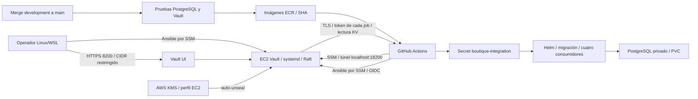

# Fase 3: Vault, Ansible y despliegue a EKS

Implementación para AWS Academy Learner Lab. Vault vive en una EC2 dedicada;
la aplicación de demostración usa `boutique-vault-lab` como namespace y release.
La ruta de secretos es `secret/boutique/lab/integration` (KV v2). El entorno
requiere una sesión activa del laboratorio y sus credenciales AWS vigentes.
La [preparación de OIDC y KMS](aws-automatic-deployment.md) permite renovar
solo esas tres credenciales en cada sesión. El diseño es de un solo nodo y
no ofrece alta disponibilidad.

## Arquitectura y contratos



El Security Group de Vault solo admite entrada TCP 8200 desde redes
administrativas de /24 o más específicas. No admite SSH. Ansible y CI usan
SSM con salida HTTPS; no necesitan abrir 8200 para los rangos de GitHub.
El túnel conserva verificación TLS mediante el SAN `localhost`. La UI directa
requiere un nombre estable incluido en SAN. La IP pública no se incluye,
porque puede cambiar al reiniciar el Lab; usar el túnel para abrir la UI.

| Clave en KV y Kubernetes | Consumidor |
| --- | --- |
| `DATABASE_URL` | catalogservice, usuario `boutique_app` |
| `MIGRATION_DATABASE_URL` | Job de migración, usuario `postgres` |
| `APP_DB_PASSWORD` | Bootstrap del rol de aplicación |
| `POSTGRES_PASSWORD` | PostgreSQL del chart y URL de migración |
| `ADMIN_EMAIL`, `ADMIN_PASSWORD` | Alta inicial del administrador |
| `ADMIN_API_TOKEN` | frontend y catalogservice |
| `CATALOG_READ_TOKEN` | productcatalogservice y catalogservice |
| `CHECKOUT_API_TOKEN` | checkoutservice y catalogservice |

No hay cambios en REST/gRPC. `postgresIntegration.rolloutRevision` es un nuevo
valor público de Helm, no secreto: identifica cada ejecución/intento, cambia
el nombre del Job y las anotaciones de los cuatro Deployments consumidores.
Los valores sensibles no pasan por Helm, Terraform ni argumentos de comandos.

## 1. Preparar el laboratorio

Desde un controlador Ubuntu 26.04 x86_64 (nativo o WSL) con Python 3.14, AWS CLI, Terraform >=1.5,
kubectl 1.35, Helm 3.22.1, GitHub CLI y GPG:

En una distribución WSL nueva, preparar Python del sistema y su soporte para
entornos virtuales. No instalar los paquetes de este proyecto con `sudo pip`:

```bash
sudo apt update
sudo apt install -y python3 python3-venv python3-pip
python3 --version
```

La versión mostrada debe ser Python 3.14.x. Desde la raíz del repositorio:

```bash
python3 -m venv .venv
source .venv/bin/activate
pip install -r ansible/requirements.txt
python -m pip check
bash scripts/vault/install-ssm-plugin.sh
export AWS_DEFAULT_REGION=us-east-1
export ANSIBLE_SSM_BUCKET=boutique-vault-ssm-NOMBRE-UNICO
export TF_STATE_BUCKET=BUCKET-DE-ESTADO-EXISTENTE
```

Cargar las tres credenciales temporales AWS usando el mecanismo del Lab;
no copiarlas a archivos versionados. Obtener VPC/subnet existentes de EKS.
Comprobar permisos y preparar el bucket dedicado antes de crear EC2:

```bash
python scripts/vault/aws_prepare.py --bucket "$ANSIBLE_SSM_BUCKET" \
  --vpc-id vpc-REEMPLAZAR --subnet-id subnet-REEMPLAZAR --create-bucket
cp terraform/aws/vault/terraform.tfvars.example terraform/aws/vault/terraform.tfvars
# Editar terraform.tfvars con esos identificadores y la IP administrativa /32.
terraform -chdir=terraform/aws/vault init -backend-config="bucket=$TF_STATE_BUCKET"
terraform -chdir=terraform/aws/vault plan
terraform -chdir=terraform/aws/vault apply
```

El preflight consulta identidad/perfil/subnet, ejecuta RunInstances con DryRun
y comprueba transferencia S3. No garantiza permisos que solo se pueden comprobar
con la instancia creada: SSM StartSession y acceso del perfil al bucket deben
pasar también. No se crean ni se amplían políticas IAM. Ante denegación, corregir
el permiso con el administrador del Lab; no sustituirlo por SSH público.

El bucket SSM es privado, AES256, sin historial de versiones y con expiración
de objetos abandonados tras un día. No reutilizar el bucket de estado. El
preflight rechaza buckets versionados, incluso si el versionado fue suspendido.

Para PostgreSQL se necesita el addon EBS CSI activo y una StorageClass
funcional. En este Learner Lab, el grupo `boutique-eq4-eks-storage` usa
`LabRole` en un nodo con taint; el controlador CSI debe fijarse a ese nodo.
Los nodos de la aplicación mantienen su rol limitado. La clase heredada `gp2`
no sustituye al CSI: usar una clase con provisioner `ebs.csi.aws.com`, probar
un PVC antes de Helm y no sustituirlo por almacenamiento efímero. Los permisos
amplios de `LabRole` hacen que esta configuración sea solo para el laboratorio.

```bash
aws eks update-kubeconfig --name boutique-eq4-eks --region us-east-1
aws eks describe-addon --cluster-name boutique-eq4-eks --addon-name aws-ebs-csi-driver
kubectl apply -f kubernetes-manifests/aws-ebs-gp3-storageclass.yaml
kubectl get storageclass
kubectl create namespace boutique-vault-lab
```

Antes de crear PostgreSQL, ejecutar el Job temporal
`kubernetes-manifests/aws-ebs-smoke.yaml`: debe completar con `ebs-ok` y el PVC
debe quedar `Bound`. El Job corre en un nodo normal, mientras el controlador
CSI permanece en el nodo `storage-controller`. Tras guardar el resultado,
eliminar `boutique-storage-smoke` para retirar el volumen de prueba.

## 2. Instalar y demostrar idempotencia

Esperar a que la instancia aparezca `Online` en Systems Manager. Ejecutar:

```bash
mkdir -p .vault-lab/evidence
(cd ansible && ansible-galaxy collection install -r requirements.yml)
(cd ansible && ansible-playbook site.yml) | tee .vault-lab/evidence/install.log
(cd ansible && ansible-playbook site.yml) | tee .vault-lab/evidence/repeat.log
python scripts/vault/check_idempotence.py .vault-lab/evidence/repeat.log
```

Conservar el código de salida de Ansible al usar `tee`: ejecutar estos comandos
en Bash con `set -euo pipefail`. Se exige `changed=0`, `failed=0` y
`unreachable=0` en la segunda ejecución. La instalación no necesita claves de
unseal ni tokens. Su health check acepta correctamente Vault nuevo o sellado.

```bash
export VAULT_ADDR=https://localhost:18200
export VAULT_CACERT="$PWD/.vault-lab/certs/INSTANCE-ID.pem"
python scripts/vault/ssm_tunnel.py --instance-id INSTANCE-ID \
  --pid-file /tmp/boutique-vault-tunnel.pid
```

Mantener el supervisor en esa terminal; Ctrl+C termina también la sesión AWS.
En otra terminal, exportar las mismas variables. Antes de init/unseal todavía
no debe pasar `health.py`. Tras unseal, debe pasar con confianza TLS verificada.
Para UI a través del túnel abrir `https://localhost:18200/ui/` e instalar el
certificado público en el almacén de confianza del navegador. La UI directa
requiere un nombre DNS estable incluido en SAN, además del CIDR permitido.

## 3. Ceremonia de bootstrap y custodia

Usar tres claves públicas PGP binarias distintas de los custodios y otra para
el token raíz. Exportarlas con `gpg --export --output <archivo> <identidad>`.
Guardar todo el material de custodia fuera del repositorio, en un directorio
privado con permisos 0700; los archivos que crea el helper son exclusivos 0600.

```bash
python scripts/vault/bootstrap.py init \
  --key-pgp "$HOME/vault-custody/alice.pub" \
  --key-pgp "$HOME/vault-custody/bob.pub" \
  --key-pgp "$HOME/vault-custody/recovery.pub" \
  --root-pgp "$HOME/vault-custody/root.pub" \
  --output "$HOME/vault-custody/init.json"
python scripts/vault/bootstrap.py unseal
# Un segundo custodio introduce otra participación en el mismo comando.
python scripts/vault/health.py
```

`init.json` contiene participaciones y token raíz cifrados por Vault con PGP.
Cada custodio descifra su participación de `keys_base64` fuera del repo y la
introduce en el prompt oculto; no compartirlas mediante Actions, capturas o logs.
Descifrar el token raíz en una sesión privada y suministrarlo al prompt de
operador de los comandos siguientes. `VAULT_TOKEN` puede suministrarse mediante
un gestor de contraseñas; no se imprime ni se almacena en Git.

```bash
python scripts/vault/bootstrap.py configure
python scripts/vault/bootstrap.py seed
python scripts/vault/bootstrap.py issue-operator --output "$HOME/vault-custody/operator.json"
```

El operador nombrado expira en 24 horas. Probar `configure` con ese token antes
de revocar el raíz. No es el token de CI y no debe almacenarse en GitHub.
Conservar acceso emitiendo un operador sustituto antes de expirar;
si todos los operadores expiran, el quorum permite `vault operator generate-root`
en una ceremonia de recuperación controlada.

```bash
# Probar con el token de operador; configure es repetible y no cambia el secreto.
python scripts/vault/bootstrap.py configure
# Suministrar explícitamente el token raíz original, no el nuevo operador:
python scripts/vault/bootstrap.py revoke-self
```

El comando `issue-ci` se conserva para ensayos manuales de ACL: produce un token
de cuatro horas. No se usa para Actions. El despliegue automático autentica con
OIDC y recibe un token batch de máximo 15 minutos, sin política predeterminada,
que solo lee `secret/data/boutique/lab/integration`.

## 4. Activar GitHub Actions

Completar la [migración KMS y configuración OIDC](aws-automatic-deployment.md)
antes de activar el environment `vault-lab`, limitado a `main`. Configuración:

| Ubicación | Nombre | Valor |
| --- | --- | --- |
| Variables del environment | `VAULT_INSTANCE_ID` | ID de la EC2 dedicada |
| Variables del environment | `VAULT_SSM_BUCKET` | Bucket dedicado de transferencias Ansible |
| Variable del environment | `VAULT_AUTOMATION_READY` | `true`, solo tras verificar migración y confianza OIDC |
| Variable de repositorio | `AWS_ACCOUNT_ID` | Cuenta esperada por el helper de renovación |
| Secrets de repositorio | `AWS_ACCESS_KEY_ID`, `AWS_SECRET_ACCESS_KEY`, `AWS_SESSION_TOKEN` | Tres valores de la misma sesión activa del Lab |

No duplicar credenciales AWS en el environment. El helper inicial elimina las
copias heredadas y el secret `VAULT_CI_TOKEN`; las variables antiguas
`ENABLE_VAULT_LAB` y `VAULT_CA_CERT_B64` ya no intervienen en CD. El certificado
público se obtiene por SSM en cada ejecución. Ninguna credencial de aplicación,
participación de recuperación ni token de operador se configura en GitHub.

Para cada sesión posterior, con GitHub CLI autenticado y las tres claves nuevas
ya exportadas en Ubuntu, transferirlas sin imprimir valores:

```bash
python3 scripts/vault/configure_actions.py \
  --repo OWNER/REPOSITORY --rotate-aws-only
```

Un merge de `development` a `main` del mismo repositorio ejecuta PostgreSQL y
pruebas Vault sobre el SHA del merge, construye las doce imágenes ECR y llama al
CD reutilizable con ese SHA. También despliega cambios solo en documentación.
El deploy manual acepta un SHA completo, ancestro de `main`, cuyas imágenes
deben existir. El job reanuda instancias conocidas, aplica Ansible, verifica CSI,
abre SSM, valida TLS, autentica OIDC, lee KV con `vault-action` y despliega con
`--atomic --wait --wait-for-jobs`.
Las nuevas pruebas Vault son obligatorias antes del build ECR.

La verificación funcional reutiliza la suite HTTP/gRPC/PostgreSQL existente
dentro de catalogservice. Crea productos/pedidos sintéticos, archiva sus SKU,
prueba login, catálogo y checkout y deja pedidos de demostración. Pago, envío y
correo siguen usando los simuladores. El frontend queda privado:

```bash
kubectl -n boutique-vault-lab port-forward service/frontend 8080:80
```

Abrir `http://localhost:8080`. El modo lab usa cookie no Secure para este túnel
HTTP local; Vault siempre usa TLS. La contraseña administrativa se consulta
mediante la sesión privada de operador en Vault, nunca en logs de Actions.

## 5. Rotación, fallos y recuperación

```bash
python scripts/vault/bootstrap.py seed --rotate-api-tokens
```

Después repetir CD con el mismo SHA construido. Cambian exclusivamente los
tres tokens de servicio; las contraseñas de base y del administrador se
conservan. La nueva revisión de despliegue renueva los cuatro consumidores y el
Job de migración. Puede haber errores transitorios entre consumidores durante
el rollout; no se promete rotación sin interrupciones.

El CD rechaza cambios automáticos en credenciales de PostgreSQL o bootstrap:
el script de migración solo crea roles que faltan, y `POSTGRES_PASSWORD` no
cambia una contraseña de una base ya inicializada. Para rotar contraseñas:
ventana controlada, backup y prueba de restauración, detener consumidores,
ejecutar `ALTER ROLE` mediante sesión SQL privada sin historial/logs de valores,
actualizar conjuntamente URLs/contraseñas en Vault y el Secret, reiniciar y
validar. Preparar también la reversión SQL. No usar `helm --set` para secretos.

Ante fallo de Vault, token, TLS o valores incompletos no se modifica Kubernetes.
Ante fallo de Helm/smoke se restaura el Secret previo, se revierte la release,
se renuevan consumidores y se repite smoke con credenciales previas.
Si el primer despliegue falló pero creó un PVC, se retiene el Secret nuevo:
eliminarlo podría hacer inaccesible la base en la siguiente ejecución.
Si aparece `RECOVERY REQUIRED`, preservar Secret/PVC y resolver el estado de
Helm antes de reintentar; no inventar contraseñas nuevas.

| Ensayo remoto, siempre en el lab aislado | Resultado exigido |
| --- | --- |
| Token expirado o revocado | Lectura denegada; Secret y release intactos |
| ACL de CI temporalmente en `deny` | Fallo de lectura y recuperación al restaurar política |
| `vault operator seal` | Vault no disponible; unseal con quorum y repetición del mismo SHA |
| Retirar una clave en una versión KV de prueba | Validación falla antes de escribir Kubernetes |
| Interrumpir SSM | Fallo TLS/conexión; ninguna actualización parcial |
| Rotar tokens API | Nuevo intento del mismo SHA pasa login, catálogo y checkout |
| Reiniciar EC2 antes de la migración | Raft conservado, unseal con quorum y lectura del mismo secreto |
| Reiniciar EC2 después de la migración KMS | Auto-unseal sin participaciones y lectura del mismo secreto |
| Reiniciar PostgreSQL/pods | Datos y sesiones conservados por el PVC/base |

Registrar revisión de Helm y `resourceVersion` del Secret antes/después sin
extraer `data`. Restaurar cada alteración antes del siguiente ensayo. No sellar
Vault ni cambiar políticas de un entorno compartido durante actividad real.

### Recuperar acceso cuando una clave PGP no se abre

Si dos custodios todavía pueden descifrar sus participaciones, abrir Vault con
ese quorum y conservar la instalación. La generación de otro token raíz no
requiere descifrar el token raíz original ni reinicializar el almacenamiento.
En Vault 2.2, `generate-root` exige autenticación por defecto. Este helper usa
SSM/Ansible para habilitar temporalmente solo esa familia de endpoints, recarga
con SIGHUP y vuelve a exigir autenticación al terminar o al fallar.

```bash
export GPG_TTY="$(tty)"
export RECOVERED_ROOT="$HOME/vault-custody/root-recovered-$(date -u +%Y%m%d-%H%M%S).json"
python scripts/vault/recover_root.py \
  --instance-id INSTANCE-ID \
  --init-file "$HOME/vault-custody/init.json" \
  --shares 2 3 \
  --recipient-pgp "$HOME/vault-custody/custodio2.pub" \
  --output "$RECOVERED_ROOT"
```

Se requiere la sesión AWS activa, `ANSIBLE_SSM_BUCKET`, el entorno virtual de
Ansible, el túnel SSM y `VAULT_CACERT`. El helper valida primero ambas claves y
prueba localmente el destinatario elegido. Guarda el nuevo token cifrado con PGP
en un archivo exclusivo 0600 fuera del repo, verifica el token en memoria y
comprueba HTTP 403 al cerrar la ventana. No imprime participaciones ni tokens.
Generar un nuevo token no revoca el token raíz anterior; gestionar sus accessors
en la sesión administrativa posterior, después de verificar al operador.

Si la terminal se cierra por la fuerza o no aparece la confirmación de cierre,
restablecerlo con la misma sesión AWS y el túnel disponibles:

```bash
python scripts/vault/recover_root.py --instance-id INSTANCE-ID --close-only
```

Después configurar Vault, emitir y comprobar el operador antes de revocar los
tokens raíz. Sustituir la clave PGP inaccesible mediante una ceremonia de rekey
con verificación, conservar las participaciones anteriores hasta completar esa
ceremonia y renovar las copias cifradas de custodia.

Para Vault con KMS nativo, usar el `init.json` de la custodia de **esa misma
instalación**, conservada en el artefacto `local-bootstrap-verification`.
El archivo exterior y cada participación están cifrados con PGP. Descifrar el
contenedor en memoria y conservar únicamente el miembro regular `init.json`
en un directorio 0700, archivo 0600, fuera de Git. No imprimir su contenido ni
extraer el snapshot en texto claro. El helper selecciona `recovery_keys_base64`
para KMS nuevo y conserva compatibilidad con participaciones Shamir después de
una migración KMS completada; rechaza migraciones pendientes y custodia incompleta.

Si el propósito es reparar la confianza OIDC, después de confirmar el cierre
de la ventana ejecutar, con el mismo túnel y las claves aún desbloqueadas:

```bash
python scripts/vault/repair_github_oidc.py \
  --root-file "$RECOVERED_ROOT" \
  --gpg-home "$HOME/vault-custody/gnupg" \
  --repo Hacket00GTFO/Boutique-Eq4-DevOPS \
  --repository-id 1333737803 --owner-id 181441407
```

El root recuperado se descifra solo en memoria. Emite un operador de quince
minutos, sin política `root` ni política predeterminada, comprueba sus límites
y revoca el root antes de actualizar la confianza. El operador se revoca al
terminar, incluso si la configuración del rol falla. Un error de revocación
detiene la operación y requiere comprobar la sesión antes de reintentar.
La escritura verificada del rol no acredita el login real de GitHub: esa prueba
sigue siendo obligatoria dentro del bootstrap antes de activar CD.

Referencias: [configuración de acceso de recuperación](https://developer.hashicorp.com/vault/docs/configuration#enable_unauthenticated_access)
y [API de generación por quorum](https://developer.hashicorp.com/vault/api-docs/system/generate-root).

### Reconstrucción

Guardar previamente `vault operator raft snapshot save` en custodia externa;
el snapshot sigue cifrado y necesita las participaciones originales al
restaurarse. El bucket de transferencias no es un almacén de backups.

```bash
# Destruye solo los dos recursos administrados por el stack independiente.
bash scripts/vault/rebuild-lab.sh --confirm-destroy-vault-lab
# Ensayo desde cero, eliminando también datos de aplicación del namespace lab:
bash scripts/vault/rebuild-lab.sh --confirm-destroy-vault-lab --destroy-app-data
```

El helper valida el contenido del estado, recrea Terraform, espera SSM, ejecuta
Ansible dos veces y exige idempotencia. Inicialización/unseal y custodia son
ceremonias separadas, no tareas desatendidas con claves maestras en CI.
Si se conservaron PVCs, restaurar snapshot/secretos originales antes de CD.
Si se eliminó todo el entorno lab, hacer init/unseal/configure/seed nuevos.
Actualizar ID de instancia, certificado y token de CI y repetir el SHA.
El helper nunca destruye EKS, DynamoDB, otros namespaces ni el bucket de estado.

## 6. Validación y portafolio

```bash
export VAULT_TEST_BINARY=/ruta/al/binario/vault
python -m unittest discover -s scripts/vault/tests -v
python scripts/vault/validate_chart.py
(cd ansible && ansible-playbook -i 'localhost,' site.yml --syntax-check)
(cd ansible && ansible-lint site.yml roles/*/tasks/main.yml roles/*/handlers/main.yml)
terraform -chdir=terraform/aws/vault init -backend=false
terraform -chdir=terraform/aws/vault validate
```

Las pruebas levantan su propio Vault TLS con Raft en un directorio temporal;
no contactan AWS ni usan secretos del proyecto. Sin `VAULT_TEST_BINARY`, los
casos reales se marcan omitidos: no cuentan como evidencia de ejecución.
CI exige ese binario verificado y corre además lint/render de Helm y Ansible.

Completar [la matriz de evidencias](vault-evidence.md) con enlaces a ejecuciones,
capturas de UI sin valores, SG, recaps de Ansible, auditoría anonimizada,
reconstrucción, rotación y recuperación. `.vault-lab` está excluido de Git:
solo incorporar copias revisadas y redactadas al portafolio público.
Las cuatro dimensiones anunciadas por la rúbrica solo tienen tres descripciones
visibles: seguridad, UI y portafolio. Confirmar la cuarta antes de asignar nota.
